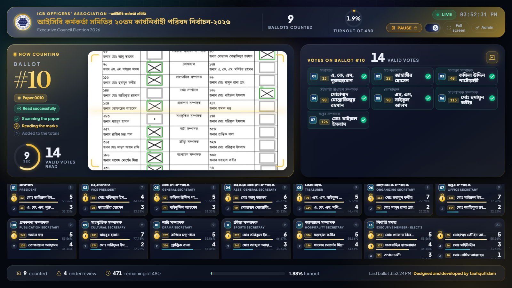

# ICB Officers' Association Election System

Counts paper ballots automatically. Members vote on the printed ballot with a pen,
one person scans the papers, the scans are dropped into a **Scanned** folder, and
the system reads the marked boxes, stores every vote in a SQLite database, moves
the file to **Completed**, and updates a live results dashboard in real time.

| Part | Technology |
|---|---|
| Backend API | Python 3.11+ · FastAPI 0.141.1 · SQLAlchemy (async) · SQLite |
| Ballot reading | PDF (pypdfium2) or image (JPG/PNG/TIFF/BMP/WebP, any DPI, auto-rotated) + OpenCV mark detection, no Tesseract / poppler needed |
| Frontend | Next.js 16.3.5 · React 19 · TypeScript |
| Live updates | Server-Sent Events (push on every change) |
| Deployment | Docker Compose, or plain Python + Node on Windows / Linux |

## Public live screen



Every counted ballot is shown on the projector for 20 seconds (scanned paper,
detected marks, the votes on it) while the totals for all 13 posts grow one by
one, so voters and candidates can follow the count.

## Documentation

| Document | What it is for |
|---|---|
| [docs/RUN_WITHOUT_DOCKER.md](docs/RUN_WITHOUT_DOCKER.md) | **Running with plain Python + Node.js, no Docker** (PC or office server) |
| [docs/INSTALL.md](docs/INSTALL.md) | Installing the requirements (simple, step by step) |
| [docs/RUNNING.md](docs/RUNNING.md) | Running on a local PC, on a server, and with Docker (+ Docker checklist) |
| [docs/WALKTHROUGH.md](docs/WALKTHROUGH.md) | Election-day walkthrough: setup, scanning, review, publishing |
| [docs/CODE_GUIDE.md](docs/CODE_GUIDE.md) | How the code works, where to change things |

## Quick start (Windows, no Docker)

1. **`0. install.bat`** — once on every PC (needs the internet, asks for
   administrator rights). It finds or installs Python 3.14 (default folder
   `C:\Python\Python314`; other Python versions are not touched) and Node.js,
   then builds a **new `icbOfficerAssoAPI\.venv` for this PC**. A `.venv` copied
   from another computer does not work there (`No module named
   'pydantic_core._pydantic_core'`), so it is replaced. After that it installs
   all packages, builds the UI, and publishes it through IIS on port 80 (it adds
   URL Rewrite + Application Request Routing, an `/election` application, and a
   firewall rule). The versions, folders and URL prefix are set at the top of
   `0. install.bat`.
2. **`1. Start.bat`** — every time. Then from any PC on the LAN:

| Page | URL |
|---|---|
| Admin panel | http://&lt;this-pc-ip&gt;/election/admin (e.g. http://192.168.15.57/election/admin) |
| Public live dashboard | http://&lt;this-pc-ip&gt;/election/dashboard |

IIS only forwards requests, so the system must be started with `1. Start.bat`.
Other IIS sites on the PC keep working.
The live screen's event stream goes straight to the API on port 8000 (the IIS
proxy would hold it back, and the countdown / zoom would never start), so
`0. install.bat` also opens port 8000 in the firewall.

## Reports (Admin → Reports)

Four sheets to print, sign and submit; **Print / Save as PDF** opens the browser's
print dialog with the paper size already set (choose *Save as PDF*):

1. **Result Summary** (A4 portrait): figures, the elected candidate(s) of every
   post with their lead, ties flagged for the Election Commission, and the
   signature block on page 1; the votes of every candidate as a signed annex.
2. **Ballot-wise Vote Tally** (A4/A3/Legal landscape): one row per counted
   ballot, one column per candidate, 1 = vote counted / 0 = none, the total per
   candidate at the end (the same numbers as the summary), headings and
   "Initials" line on every page; also as Excel (CSV).
3. **Panel Votes** (A4 portrait), with a **Panel Left / Panel Right** drop-down:
   the candidates printed on that side of the ballot paper, their votes, rank
   and result, the panel's total and share of the valid votes, and how many
   ballots voted for the whole panel / only for that panel.
4. **Null Votes** (A4 portrait): every vote that is not counted — by reason
   (ballot rules ক/খ/গ, not counted by the Election Commission), post by post
   (with the ballots left blank for the post), every such mark one by one with
   its ballot number, and the scanned files that could not be read.

The signature titles are editable on the page and remembered in the browser.

## Quick start (Docker)

```bash
cp .env.example .env          # edit passwords / secret
docker compose up --build -d
```

Then open (Docker serves the UI from the root, without `/election`):

| Page | URL |
|---|---|
| Admin panel | http://localhost:3000/admin (default login `admin` / `admin123`) |
| Public live dashboard | http://localhost:3000/dashboard |
| API documentation | http://localhost:8000/docs |

## How it works in one picture

```
 paper ballot ──scan──▶ data/Scanned/*.pdf
                              │  folder watcher (instant) + 5 s sweep
                              ▼
                     OpenCV mark detection ──▶ votes in SQLite ──▶ SSE push ──▶ dashboard
                              │
                              ├─ ok            ──▶ data/Completed/   (status: processed)
                              ├─ suspicious    ──▶ data/Completed/   (status: needs_review → admin checks)
                              └─ unreadable    ──▶ data/Failed/      (status: error)
```

## Project layout

```
ICBOfficersAssoElection/
├── docker-compose.yml, docker-compose.dev.yml, .env(.example)
├── data/                 Scanned / Completed / Failed / Previews + the SQLite DB (created at runtime)
├── docs/                 documentation
├── scripts/              setup / start helpers for Windows and Linux
├── icbOfficerAssoAPI/    FastAPI backend  (app/, tests/, scripts/make_sample_ballots.py)
└── icbOfficerAssoUI/     Next.js frontend (src/app, src/components, src/hooks, src/lib)
```

## Tests

```bash
cd icbOfficerAssoAPI && .venv/Scripts/python -m pytest      # 23 tests: OCR + full API flow
cd icbOfficerAssoUI  && npm run lint && npm run build
```
