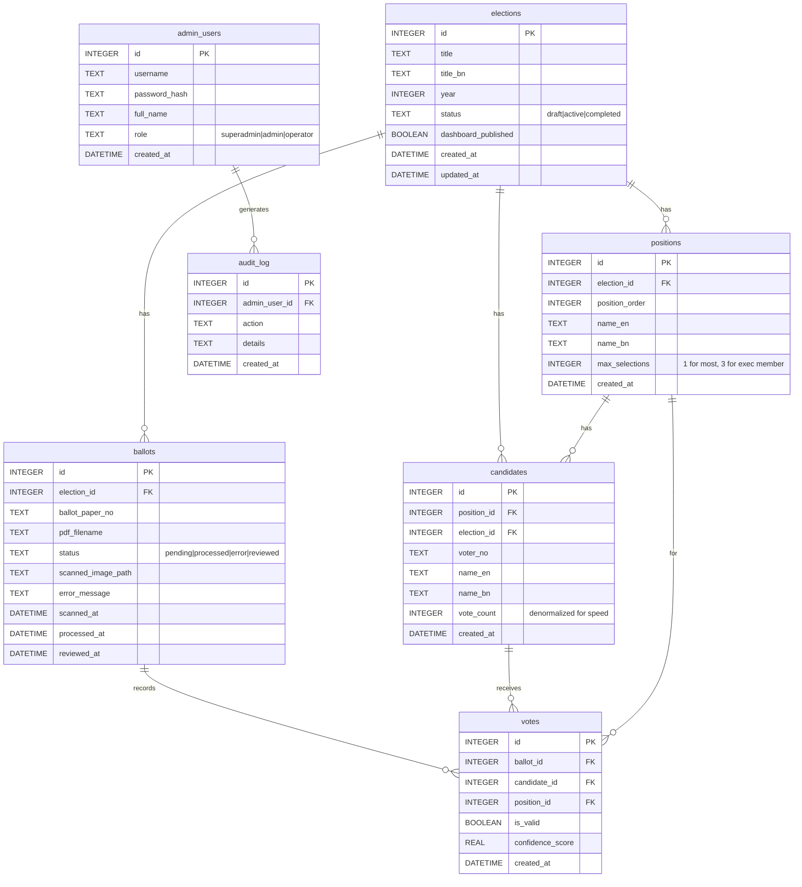
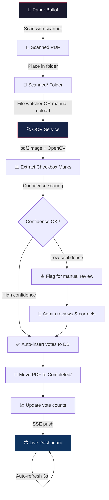

# ICB Officers' Association Election Voting System

A full-stack application to digitize the ballot counting process for the ICB Officers' Association's biennial executive council election. The system reads scanned ballot papers (PDFs), extracts vote data using OCR, tallies results in a SQLite database, and displays a live-updating dashboard.

## Background & Analysis

### From Resource Files

The ballot paper ([ballot.jpg](file:///D:/Work%20Place/ICB/ICBOfficersAssoElection/resources/ballot.jpg)) reveals:
- **Title**: আইসিবি কর্মকর্তা সমিতির ৩০তম কার্যনির্বাহী পরিষদ নির্বাচন-২০২৬
- **13 position categories** with **30 total candidates**:
  - Positions 01–12: 2 candidates each (24 candidates)
  - Position 13 (নির্বাহী সদস্য / Executive Member): 6 candidates
- Each candidate row has: Voter No., Candidate Name, and a **checkbox** (☐) to mark with ✕
- **Ballot Paper Number** field at top-right corner
- Instructions at bottom: mark ✕ next to chosen candidate

The handwritten notes ([1.jpeg](file:///D:/Work%20Place/ICB/ICBOfficersAssoElection/resources/1.jpeg), [2.jpeg](file:///D:/Work%20Place/ICB/ICBOfficersAssoElection/resources/2.jpeg)) specify:
1. Admin uploads scanned PDF → system reads it → inserts into DB → moves PDF to "Completed" folder
2. Dashboard auto-refreshes every 3–5 seconds
3. Admin can see details of each uploaded vote + summary
4. Admin can **pause / publish / update** the dashboard at any time

### Positions & Candidates (from Ballot)

| # | Position (Bengali) | Position (English) | Candidates |
|---|---|---|---|
| 01 | সভাপতি | President | 101 – জনাব এবি, 102 – জনাব সিডি |
| 02 | সহ-সভাপতি | Vice President | 103 – জনাব বিই, 104 – জনাব ডিসি |
| 03 | সাধারণ সম্পাদক | General Secretary | 105 – জনাব এমএন, 106 – জনাব বিডি |
| 04 | সহকারী সাধারণ সম্পাদক | Asst. General Secretary | 107 – জনাব সবি, 108 – জনাব আব |
| 05 | কোষাধ্যক্ষ | Treasurer | 109 – জনাব মনা, 110 – জনাব জবা |
| 06 | সাংগঠনিক সম্পাদক | Organizing Secretary | 111 – জনাব পল, 112 – জনাব মট |
| 07 | দপ্তর সম্পাদক | Office Secretary | 113 – জনাব খব, 114 – জনাব দখ |
| 08 | প্রকাশনা সম্পাদক | Publication Secretary | 115 – জনাব বশ, 116 – জনাব ইব |
| 09 | সাংস্কৃতিক সম্পাদক | Cultural Secretary | 117 – জনাব খব, 118 – জনাব ডুগ |
| 10 | নাট্য সম্পাদক | Drama Secretary | 119 – জনাব তথ, 120 – জনাব চব |
| 11 | ক্রীড়া সম্পাদক | Sports Secretary | 121 – জনাব তুক, 122 – জনাব চড |
| 12 | আপ্যায়ন সম্পাদক | Hospitality Secretary | 123 – জনাব জব, 124 – জনাব গ্রেহ |
| 13 | নির্বাহী সদস্য | Executive Member (elect 3) | 125–130 (6 candidates) |

---

## User Review Required

> [!IMPORTANT]
> **PDF/Scanned Ballot Reading Strategy**: The scanned ballots are handwritten ✕ marks in checkboxes. We will use **Tesseract OCR + OpenCV** image processing to detect marked checkboxes. This approach works well for structured forms with known layouts. The ballot template is fixed, so we can define checkbox regions programmatically.

> [!WARNING]
> **OCR Accuracy**: Handwritten marks on scanned paper can have varying quality. The system will include a **manual review/correction UI** so the admin can verify and fix any misread ballots before finalizing the count.

> [!IMPORTANT]
> **Candidate Data**: The candidate names in the ballot appear to be placeholders (জনাব এবি, জনাব সিডি, etc.). The admin panel will include a **candidate management** feature to set actual candidate names and voter numbers before the election starts.

---

## Open Questions

> [!IMPORTANT]
> **1. Scanned PDF Format**: Will each scanned PDF contain a single ballot page, or could multiple ballot pages be combined into one PDF? The plan assumes **one ballot per PDF file** — please confirm.

> [!IMPORTANT]
> **2. Position 13 — Executive Member**: The ballot shows 6 candidates for নির্বাহী সদস্য. How many can a voter select? The plan assumes **3 out of 6** (to fill the remaining 3 of the 15 elected positions). Please confirm.

> [!NOTE]
> **3. Authentication**: Should the admin panel require login credentials? The plan includes a simple admin login with username/password. No public user authentication is needed since the dashboard is view-only.

> [!NOTE]
> **4. Folder Paths**: The "Scanned" and "Completed" folders will be configurable via environment variables. Default paths will be inside the project's `data/` directory.

---

## Tech Stack

| Layer | Technology | Version |
|---|---|---|
| **Frontend** | Next.js (App Router, TypeScript) | 16.3.5 |
| **Backend** | Python FastAPI | 0.141.1 |
| **Database** | SQLite (via SQLAlchemy + aiosqlite) | — |
| **OCR Engine** | Tesseract OCR + OpenCV | Latest |
| **PDF Processing** | pdf2image (poppler) + Pillow | Latest |
| **Real-time** | Server-Sent Events (SSE) via FastAPI | — |
| **Containerization** | Docker + Docker Compose | — |
| **Styling** | Vanilla CSS with modern design system | — |

---

## Database Schema (SQLite: `icbOfficerAssoDB`)



---

## Proposed Changes

### Project Structure

```
ICBOfficersAssoElection/
├── docker-compose.yml
├── .env
├── .env.example
├── README.md
├── resources/                          # Existing resource files
│
├── icbOfficerAssoAPI/                  # Backend (FastAPI)
│   ├── Dockerfile
│   ├── requirements.txt
│   ├── alembic.ini
│   ├── alembic/
│   │   └── versions/
│   ├── app/
│   │   ├── __init__.py
│   │   ├── main.py                     # FastAPI app entry point
│   │   ├── config.py                   # Settings & env config
│   │   ├── database.py                 # SQLAlchemy + SQLite setup
│   │   ├── models/                     # SQLAlchemy ORM models
│   │   │   ├── __init__.py
│   │   │   ├── election.py
│   │   │   ├── position.py
│   │   │   ├── candidate.py
│   │   │   ├── ballot.py
│   │   │   ├── vote.py
│   │   │   ├── admin_user.py
│   │   │   └── audit_log.py
│   │   ├── schemas/                    # Pydantic request/response schemas
│   │   │   ├── __init__.py
│   │   │   ├── election.py
│   │   │   ├── candidate.py
│   │   │   ├── ballot.py
│   │   │   ├── dashboard.py
│   │   │   └── auth.py
│   │   ├── routers/                    # API route handlers
│   │   │   ├── __init__.py
│   │   │   ├── auth.py                 # Login, JWT tokens
│   │   │   ├── elections.py            # Election CRUD
│   │   │   ├── candidates.py           # Candidate management
│   │   │   ├── ballots.py              # Upload, process, review
│   │   │   ├── dashboard.py            # Live results + SSE
│   │   │   └── admin.py                # Dashboard publish/pause
│   │   ├── services/                   # Business logic
│   │   │   ├── __init__.py
│   │   │   ├── ocr_service.py          # PDF → image → checkbox detection
│   │   │   ├── ballot_processor.py     # Orchestrate scan → DB
│   │   │   ├── file_watcher.py         # Watch "Scanned" folder
│   │   │   └── vote_counter.py         # Tally & ranking logic
│   │   └── utils/
│   │       ├── __init__.py
│   │       ├── security.py             # Password hashing, JWT
│   │       └── helpers.py
│   └── data/                           # Runtime data (mounted volume)
│       ├── Scanned/                    # Drop scanned PDFs here
│       ├── Completed/                  # Processed PDFs moved here
│       └── icbOfficerAssoDB.db         # SQLite database file
│
└── icbOfficerAssoUI/                   # Frontend (Next.js 16)
    ├── Dockerfile
    ├── package.json
    ├── next.config.ts
    ├── tsconfig.json
    ├── public/
    │   └── icb-logo.png
    ├── src/
    │   ├── app/
    │   │   ├── layout.tsx              # Root layout with fonts
    │   │   ├── page.tsx                # Public dashboard (redirect)
    │   │   ├── globals.css             # Design system & tokens
    │   │   ├── dashboard/
    │   │   │   └── page.tsx            # Public live results dashboard
    │   │   └── admin/
    │   │       ├── layout.tsx          # Admin layout with sidebar
    │   │       ├── login/
    │   │       │   └── page.tsx        # Admin login page
    │   │       ├── page.tsx            # Admin dashboard overview
    │   │       ├── elections/
    │   │       │   └── page.tsx        # Election management
    │   │       ├── candidates/
    │   │       │   └── page.tsx        # Candidate management
    │   │       ├── ballots/
    │   │       │   ├── page.tsx        # Ballot upload & review list
    │   │       │   └── [id]/
    │   │       │       └── page.tsx    # Individual ballot review
    │   │       ├── results/
    │   │       │   └── page.tsx        # Detailed results + controls
    │   │       └── settings/
    │   │           └── page.tsx        # System settings
    │   ├── components/
    │   │   ├── ui/                     # Reusable UI components
    │   │   │   ├── Button.tsx
    │   │   │   ├── Card.tsx
    │   │   │   ├── Modal.tsx
    │   │   │   ├── Table.tsx
    │   │   │   ├── Badge.tsx
    │   │   │   ├── Input.tsx
    │   │   │   ├── Sidebar.tsx
    │   │   │   └── Loader.tsx
    │   │   ├── dashboard/
    │   │   │   ├── LiveResults.tsx      # Real-time vote tally
    │   │   │   ├── PositionCard.tsx     # Per-position result card
    │   │   │   ├── VoteProgressBar.tsx  # Animated vote bar
    │   │   │   ├── StatsOverview.tsx    # Summary statistics
    │   │   │   └── ElectionHeader.tsx   # Election title & status
    │   │   ├── admin/
    │   │   │   ├── BallotUploader.tsx   # Drag & drop PDF upload
    │   │   │   ├── BallotReview.tsx     # Review extracted votes
    │   │   │   ├── CandidateForm.tsx    # Add/edit candidates
    │   │   │   └── DashboardControls.tsx # Publish/pause toggle
    │   │   └── charts/
    │   │       ├── VoteBarChart.tsx     # Horizontal bar chart
    │   │       └── VotePieChart.tsx     # Pie chart per position
    │   ├── hooks/
    │   │   ├── useSSE.ts               # Server-Sent Events hook
    │   │   ├── useAuth.ts              # Auth context hook
    │   │   └── useApi.ts               # API client hook
    │   ├── lib/
    │   │   ├── api.ts                  # Fetch wrapper for backend
    │   │   └── constants.ts            # Position names, configs
    │   └── context/
    │       └── AuthContext.tsx          # Auth state provider
    └── ...
```

---

### Root — Docker & Configuration

#### [NEW] `docker-compose.yml`
- Defines two services: `api` (FastAPI) and `ui` (Next.js)
- Shared volume for `data/` directory (Scanned, Completed, SQLite DB)
- Environment variables for folder paths, DB location, JWT secret
- API on port **8000**, UI on port **3000**
- Network bridge for inter-service communication

#### [NEW] `.env.example`
- `SCANNED_FOLDER_PATH`, `COMPLETED_FOLDER_PATH`, `DATABASE_URL`
- `JWT_SECRET_KEY`, `ADMIN_DEFAULT_PASSWORD`
- `NEXT_PUBLIC_API_URL=http://localhost:8000`

---

### Backend — `icbOfficerAssoAPI/`

#### [NEW] `Dockerfile`
- Python 3.12 slim base
- Install Tesseract OCR, poppler-utils (for pdf2image), OpenCV dependencies
- Copy requirements, install Python deps, copy app code
- Expose port 8000, run with uvicorn

#### [NEW] `requirements.txt`
Key dependencies:
```
fastapi==0.141.1
uvicorn[standard]
sqlalchemy[asyncio]
aiosqlite
python-jose[cryptography]
passlib[bcrypt]
python-multipart
pdf2image
Pillow
pytesseract
opencv-python-headless
numpy
watchdog
sse-starlette
pydantic-settings
```

#### [NEW] `app/main.py`
- FastAPI application with CORS middleware
- Include all routers
- Startup event: initialize DB, create default admin, start file watcher
- Shutdown event: stop file watcher

#### [NEW] `app/config.py`
- Pydantic Settings for environment variables
- Paths for Scanned/Completed folders, DB URL, JWT config

#### [NEW] `app/database.py`
- Async SQLAlchemy engine with aiosqlite
- Session factory, Base model class
- `init_db()` to create all tables

#### [NEW] `app/models/` — SQLAlchemy ORM models
- All 7 tables as defined in the schema above
- Relationships between models

#### [NEW] `app/schemas/` — Pydantic schemas
- Request/response models for all API endpoints
- Dashboard data schema with position-wise vote counts

#### [NEW] `app/routers/auth.py`
- `POST /api/auth/login` — Returns JWT token
- `GET /api/auth/me` — Current user info

#### [NEW] `app/routers/elections.py`
- CRUD for elections
- `POST /api/elections/{id}/seed` — Seed default positions & candidates from ballot template

#### [NEW] `app/routers/candidates.py`
- CRUD for candidates per position
- Bulk import from template

#### [NEW] `app/routers/ballots.py`
- `POST /api/ballots/upload` — Upload scanned PDF(s)
- `POST /api/ballots/{id}/process` — Trigger OCR processing
- `GET /api/ballots` — List all ballots with status
- `GET /api/ballots/{id}` — Ballot detail with extracted votes
- `PUT /api/ballots/{id}/review` — Admin corrects/confirms extracted votes
- `POST /api/ballots/scan-folder` — Process all PDFs in Scanned folder

#### [NEW] `app/routers/dashboard.py`
- `GET /api/dashboard/results` — Current vote tally (JSON)
- `GET /api/dashboard/stream` — SSE endpoint for real-time updates (pushes every 3 seconds)
- `GET /api/dashboard/stats` — Summary stats (total ballots, processed, errors)

#### [NEW] `app/routers/admin.py`
- `PUT /api/admin/dashboard/publish` — Toggle dashboard visibility
- `PUT /api/admin/dashboard/pause` — Pause/resume live updates
- `GET /api/admin/audit-log` — View audit trail

#### [NEW] `app/services/ocr_service.py`
- Convert PDF page to image using `pdf2image`
- Use OpenCV to:
  1. Preprocess image (grayscale, threshold, deskew)
  2. Detect ballot structure (grid lines, cells)
  3. Locate checkbox regions based on known ballot template coordinates
  4. Detect ✕ marks in each checkbox region (pixel density analysis)
- Return structured data: `{position_id: selected_candidate_voter_no}`
- Include confidence score for each detection

#### [NEW] `app/services/ballot_processor.py`
- Orchestrate: receive PDF → OCR → validate → insert votes → move file
- Transaction-safe: rollback if any step fails
- Update denormalized `vote_count` on candidates table

#### [NEW] `app/services/file_watcher.py`
- Use `watchdog` library to monitor `Scanned/` folder
- On new PDF detected → auto-trigger processing pipeline
- Log events to audit trail

#### [NEW] `app/services/vote_counter.py`
- Aggregate votes per candidate per position
- Calculate percentages, rankings, leading candidates
- Detect invalid ballots (multiple marks for single-select positions)

---

### Frontend — `icbOfficerAssoUI/`

#### [NEW] `Dockerfile`
- Node 22 Alpine base
- Install dependencies, build Next.js, run with `next start`
- Expose port 3000

#### [NEW] Core Setup Files
- `package.json` with Next.js 16.3.5, TypeScript
- `next.config.ts` with API proxy rewrites to backend
- `tsconfig.json`

#### [NEW] `src/app/globals.css` — Design System
- CSS custom properties for color palette (deep navy, emerald green, gold accents)
- Dark mode support with glassmorphism effects
- Typography using Google Fonts (Inter)
- Animation keyframes for micro-interactions
- Responsive breakpoints

#### [NEW] `src/app/dashboard/page.tsx` — Public Dashboard
- **Hero section** with election title, ICB logo, election status
- **Real-time vote tally** with animated progress bars per position
- **Position cards** showing each position with candidates, vote counts, leading indicator
- **Stats bar**: Total ballots processed, remaining, percentage complete
- Auto-refresh via SSE (Server-Sent Events) — no page reload needed
- **Glassmorphic card design** with subtle animations
- Responsive: works on large TV displays, tablets, and phones

#### [NEW] `src/app/admin/` — Admin Panel Pages
- **Login page**: Secure admin authentication
- **Admin Dashboard**: Overview with processing statistics, recent activity
- **Ballot Management**: Upload PDFs (drag & drop), view processing queue, review individual ballots with side-by-side (scanned image vs extracted data), approve/reject/correct
- **Candidate Management**: Add/edit/remove candidates for each position
- **Results Control**: Detailed results view, publish/pause toggle, export results
- **Settings**: Configure folder paths, election details

#### [NEW] `src/components/` — Reusable Components
- **UI primitives**: Button, Card, Modal, Table, Badge, Input, Sidebar, Loader
- **Dashboard components**: LiveResults, PositionCard, VoteProgressBar with CSS animations
- **Chart components**: Custom CSS-based bar charts (no external chart library needed)
- **Admin components**: BallotUploader with drag-drop, BallotReview with image viewer

#### [NEW] `src/hooks/useSSE.ts`
- Custom React hook for Server-Sent Events
- Auto-reconnect on connection drop
- Parse incoming JSON vote updates
- Respect dashboard pause state

---

## Architecture Flow



---

## Verification Plan

### Automated Tests
```bash
# Backend tests
cd icbOfficerAssoAPI
pytest tests/ -v

# Frontend build verification
cd icbOfficerAssoUI
npm run build

# Docker build verification
docker-compose build
docker-compose up -d
```

### Manual Verification
1. **Docker startup**: `docker-compose up` — both services start without errors
2. **Admin login**: Navigate to `http://localhost:3000/admin/login`, login with default credentials
3. **Candidate setup**: Create election, add positions and candidates via admin panel
4. **Ballot processing**: Place a sample scanned PDF in `Scanned/` folder → verify it gets processed and moved to `Completed/`
5. **Dashboard**: Open `http://localhost:3000/dashboard` → verify vote counts update in real-time
6. **Pause/Publish**: Toggle dashboard visibility from admin panel → verify public dashboard responds
7. **Ballot review**: Upload a low-quality scan → verify it's flagged for review → manually correct and approve

### OCR Testing
- Test with the provided [ballot.jpg](file:///D:/Work%20Place/ICB/ICBOfficersAssoElection/resources/ballot.jpg) as a reference image
- Create test ballots with known marks to validate detection accuracy
- Verify checkbox detection with various scan qualities (150 DPI, 300 DPI, grayscale, color)
